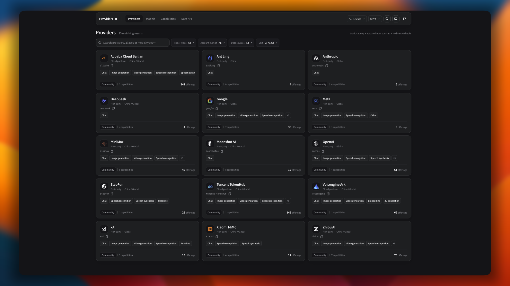

<div align="center">

# ProviderList

### See what AI providers offer and find the services that fit your needs

ProviderList brings together AI providers' models, capabilities, plans, and prices across markets. It helps people explore and compare AI services. Developers can also check API access details and their documented conditions. Recorded facts include sources for review.

[](LICENSE)
[](package.json)
[](https://providerlist.dev/docs/api)
[](https://providerlist.dev/v1/manifest.json)

[Website](https://providerlist.dev) · [API Reference](docs/api/api.md) · [Contribute](docs/guides/contributing.md) · [中文说明](README_cn.md)

</div>

<p align="center">
  
</p>

---

## What the website offers

### 1. Provider directory

[providerlist.dev/providers](https://providerlist.dev/providers) lists provider cards. You can:

- Search provider names, aliases, and model types.
- Filter by account market, such as `cn` or `global`.
- Filter by model type, such as chat, image, video, or speech.
- Filter by source, including first-party and community-maintained data.
- Sort by name, supply count, or latest release.

Counts change with each data release. See the [Manifest](https://providerlist.dev/v1/manifest.json) for the current release.

### 2. Provider pages

Each provider page can show:

- Markets and service lines offered by the provider.
- Models, model types, context limits, input/output modalities, supply status, and prices.
- Recorded API access details, including protocols, endpoints, methods, paths, and callability. Some capability pages also include parameters and route mappings.
- Plans and prices, with original currencies, billing units, and documented conditions such as region, tiers, context length, or cache TTL.
- Independent services that are not tied to a single model, such as web search, file management, and batch processing.
- Provider links and public JSON URLs.

The site presents sourced catalog information. It does not claim that API calls have been tested successfully.

### 3. Model directory

[providerlist.dev/models](https://providerlist.dev/models) lets you browse current offerings across 13 primary model types:

`chat` · `image` · `video` · `3d` · `embedding` · `reranking` · `decision` · `transcription` · `speech` · `realtime` · `music` · `world_model` · `computer_use`

Search within a type by model name, ID, or provider, and review prices with reference currency conversions. A canonical Model describes facts published by its developer; an Offering describes how a provider supplies that model in a particular market. These records are maintained separately.

### 4. Independent service capabilities

[providerlist.dev/capabilities](https://providerlist.dev/capabilities) lists services that are independent of a specific model. Details may include documented inputs, outputs, parameter constraints, routes, and asynchronous task flows such as submission, status checks, and result retrieval.

### 5. API docs and JSON Builder

[providerlist.dev/docs/api](https://providerlist.dev/docs/api) includes endpoint lists, request examples, and a provider response example. Its **JSON Builder** lets you select providers, markets, model types, supply statuses, and fields, then preview, copy, or download JSON and create a subscription URL.

ProviderList is a static, read-only catalog. It is not a model leaderboard, API proxy, or real-time availability monitor. Supply status reflects the latest trusted information; it does not guarantee that an endpoint is currently available or that a particular account has access.

## Get data

The public API serves read-only JSON without authentication. Standard `/v1/` resources are published as static files. For custom filters, use the JSON Builder to create a subscription URL such as [`/v1/providerlist.json`](https://providerlist.dev/v1/providerlist.json).

```bash
curl https://providerlist.dev/v1/manifest.json
curl https://providerlist.dev/v1/providers/minimax.json
curl https://providerlist.dev/v1/models.json
```

| Resource | Contents |
|---|---|
| [`/v1/manifest.json`](https://providerlist.dev/v1/manifest.json) | Data version and resource inventory |
| [`/v1/providers/{provider_id}.json`](https://providerlist.dev/v1/providers/minimax.json) | A provider's supply information across markets |
| [`/v1/models.json`](https://providerlist.dev/v1/models.json) | Canonical model specifications published by developers |
| [`/v1/models/type/{type}.json`](https://providerlist.dev/v1/models/type/chat.json) | Canonical models of a type referenced by reviewed Offerings |
| `/v1/models/type/all.json` | Canonical models of all types referenced by reviewed Offerings |
| `/v1/models/{developer_id}/{model_slug}.json` | One canonical Model |
| [`/v1/offerings.json`](https://providerlist.dev/v1/offerings.json) | Reviewed Offerings |
| `/v1/fx.json` | Optional reference exchange rates, when valid data is included in the release |
| [`/v1/providerlist.json`](https://providerlist.dev/v1/providerlist.json) | Subscription data filtered by Builder settings |
| `/v1/schema/*.schema.json` | Public JSON Schemas |

This table lists common resources, not every endpoint. See the [public API reference](docs/api/api.md) for all endpoints, fields, and query parameters.

Static `/v1/` resources can be cached by clients. The custom `/v1/providerlist.json` endpoint applies the filters in its URL to the current release data. It does not call provider APIs or save user settings. Versioned resources include `schema_version`, `data_version`, and `generated_at`: use `schema_version` to choose a parser and `data_version` to identify a catalog build. Breaking contract changes require a new API major version.

## How data is maintained

Provider supply information and developer-published Model specifications are recorded separately. Data comes from public sources and goes through automated checks and pull request review. Automatic collection proposes changes for review; changes become formal data after merge.

- Prices retain their original currency, billing unit, and documented conditions. Exchange conversions are for reference only.
- Unknown values remain unknown. An unknown price is not free, and an unknown limit is not unlimited.
- A single collection failure or missing catalog entry does not mark an item as retired. Retirement follows the data policy and requires review.
- Source identity, field correctness, and API callability are assessed separately. An official domain or source connection does not mean every field has been tested.
- Community-maintained data does not imply Provider participation or endorsement.

Manual changes include source links in their pull requests. Collectors use pre-registered sources and submit changes for review.

See the [online Manifest](https://providerlist.dev/v1/manifest.json) for the current data version, resource inventory, and checksums.

## Contribute

Contributions to provider supply data, model specifications, and documentation are welcome. Submit data changes through a GitHub pull request and include links that support the changes.

- [Contributing guide](docs/guides/contributing.md)
- [Provider, Service, Offering, and Plan TOML templates](docs/guides/templates/README.md)
- [Provider data pull request template](.github/PULL_REQUEST_TEMPLATE/provider-data.md)
- [Model data pull request template](.github/PULL_REQUEST_TEMPLATE/model-data.md)

## Run locally

You need Node.js 20.11 or later and pnpm 9 or later.

```bash
pnpm install
pnpm validate:data
pnpm build:catalog
pnpm dev:frontend
```

The local site runs at `http://127.0.0.1:5178`. These commands install dependencies, validate source data, build the local catalog, and start the frontend. After editing Provider or Model source files, run `pnpm build:catalog` again before checking the page; otherwise it will still show the previous build.

Run the full test suite and type check with:

```bash
pnpm test
pnpm typecheck
```

See the [contributing guide](docs/guides/contributing.md) for the full development setup and validation steps.

## Learn more

- [Documentation index](docs/README.md)
- [Architecture](docs/architecture.md)
- [Source data structure](docs/data/schema.md)
- [Pricing rules](docs/data/pricing.md)
- [Automatic ingestion](docs/guides/ingestion.md)
- [Publishing and operations](docs/guides/operations.md)
- [MIT License](LICENSE)
