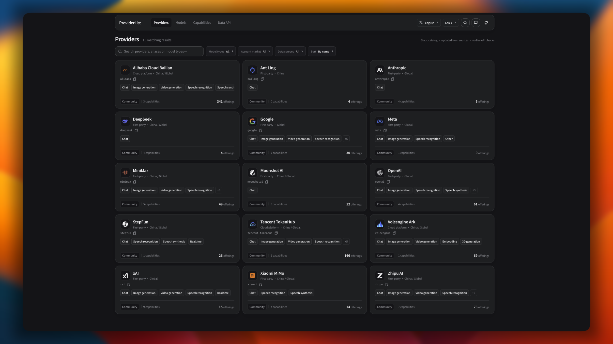

<div align="center">

# ProviderList

### 了解 AI 服务商提供什么，找到适合自己的服务

ProviderList 汇总 AI 服务商在不同市场提供的模型、服务能力、套餐与价格信息，帮助人们了解和比较 AI 服务。开发者还可以查阅 API 接入方式与相关条件。目录信息附有来源，便于核对。

[](LICENSE)
[](package.json)
[](https://providerlist.dev/docs/api)
[](https://providerlist.dev/v1/manifest.json)

[网站](https://providerlist.dev) · [公开 API 文档](docs/api/api_cn.md) · [参与贡献](docs/guides/contributing_cn.md) · [English](README.md)

</div>

<p align="center">
  
</p>

---

## 网站能做什么

### 1. 服务商目录

[providerlist.dev/providers](https://providerlist.dev/providers) 列出服务商卡片，支持：

- **搜索** 服务商名称、别名或模型类型
- **按账号市场筛选**（`cn` / `global` 等）
- **按模型类型筛选**（对话、图像、视频、语音等）
- **按来源筛选**（官方接入 / 社区整理）
- **按名称、供应数或最近发布排序**

收录数量会随数据版本更新，请以 [数据清单](https://providerlist.dev/v1/manifest.json) 为准。

### 2. 服务商详情页

点进任意服务商，可以查看：

- **服务线与账号市场**：服务商在哪些市场提供服务
- **供应的模型**：模型类型、上下文长度、输入输出模态、供应状态和价格
- **API 接入方式**：已记录的协议、Endpoint、方法、路径与适配状态；部分能力详情还会展示参数及路由映射。可复制哪些字段以页面实际提供的操作为准
- **套餐与价格**：来源币种、计费单位，以及已记录的适用条件（如区域、档位、上下文长度和缓存 TTL）
- **独立服务能力**：不绑定到单个模型的服务，如网页搜索、文件管理和批量处理
- **相关链接与数据地址**：访问服务商官网、官方文档，并复制公开 JSON 地址

页面展示的是有来源支持的目录信息，不代表本站已实测 API 调用成功。

### 3. 模型目录

[providerlist.dev/models](https://providerlist.dev/models) 按 13 类模型主类别浏览当前供应项：

`chat` · `image` · `video` · `3d` · `embedding` · `reranking` · `decision` · `transcription` · `speech` · `realtime` · `music` · `world_model` · `computer_use`

每一类都可以在类型内搜索模型名称、ID 或服务商，并查看价格与参考汇率换算。规范 Model 描述开发厂商公布的模型事实；服务商供应项描述某个服务商在特定市场如何提供该模型，二者分开维护。

### 4. 独立服务能力

[providerlist.dev/capabilities](https://providerlist.dev/capabilities) 单独列出与模型无关的服务能力。详情可展示已记录的输入输出、参数约束、调用路由，以及异步任务的提交、状态查询或结果获取信息；具体内容取决于来源资料。

### 5. API 文档与 JSON Builder

[providerlist.dev/docs/api](https://providerlist.dev/docs/api) 提供端点清单、请求示例和服务商响应示例，并内置 **JSON Builder**：选择服务商、市场、模型类型、供应状态和字段，预览、复制或下载 JSON，也可以生成订阅地址。

ProviderList 是静态只读目录，不是模型排行榜、API 代理或实时可用性监控。供应状态依据最近的可信资料，不保证接口此刻可用，也不代表特定账号已获得访问权限。

## 快速获取数据

公开 API 提供只读 JSON，无需鉴权。标准 `/v1/` 资源以静态文件发布；自定义筛选可由 JSON Builder 生成 [`/v1/providerlist.json`](https://providerlist.dev/v1/providerlist.json) 订阅地址。

```bash
curl https://providerlist.dev/v1/manifest.json
curl https://providerlist.dev/v1/providers/minimax.json
curl https://providerlist.dev/v1/models.json
```

| 资源 | 内容 |
|---|---|
| [`/v1/manifest.json`](https://providerlist.dev/v1/manifest.json) | 数据版本与资源清单 |
| [`/v1/providers/{provider_id}.json`](https://providerlist.dev/v1/providers/minimax.json) | 单个服务商在各市场的供应信息 |
| [`/v1/models.json`](https://providerlist.dev/v1/models.json) | 开发厂商公布的规范 Model 规格注册表 |
| [`/v1/models/type/{type}.json`](https://providerlist.dev/v1/models/type/chat.json) | 指定模型类型中被已审核供应项引用的规范 Model |
| `/v1/models/type/all.json` | 所有模型类型中被已审核 Offering 引用的规范 Model |
| `/v1/models/{developer_id}/{model_slug}.json` | 单个规范 Model |
| [`/v1/offerings.json`](https://providerlist.dev/v1/offerings.json) | 已审核的供应项 |
| `/v1/fx.json` | 可选参考汇率；仅在本次发布包含有效数据时提供 |
| [`/v1/providerlist.json`](https://providerlist.dev/v1/providerlist.json) | 按数据构建器条件筛选的订阅数据 |
| `/v1/schema/*.schema.json` | 公开 JSON Schema |

表中列出常用资源，并非完整端点清单。完整端点、字段和查询参数见[公开 API 文档](docs/api/api_cn.md)。

标准 `/v1/` 资源以静态 JSON 文件发布，可由客户端缓存；自定义筛选由 JSON Builder 生成 [`/v1/providerlist.json`](https://providerlist.dev/v1/providerlist.json) 订阅地址。该端点根据 URL 中的筛选条件从当前发布的数据生成结果，不调用服务商接口，也不保存用户配置。版本化资源带有 `schema_version`、`data_version` 和 `generated_at`：`schema_version` 用于选择解析器，`data_version` 用于标识目录构建。破坏性契约变更需要新的 API 主版本。

完整字段与查询参数见[公开 API 文档](docs/api/api_cn.md)。

## 数据如何维护

服务商供应信息与开发厂商公布的 Model 规格分开记录。数据来自公开来源，并经过自动校验和 Pull Request 审核；自动采集只提交待审核的变更，合并后才成为正式数据。

- **价格保留原币种、计费单位和适用条件**；汇率换算仅供参考，不替代原始报价。
- **缺少可信信息时保持未知**；未知价格不等于免费，未知限制不等于无限制。
- **单次采集失败或目录缺项不会直接判定退役**；退役需要符合数据政策并经过审核。
- **来源身份、字段正确性和接口可调用性分别判断**；官方域名或来源接入不等于所有字段都经过实测。
- **社区整理不代表服务商参与或背书**。

手动修改在 Pull Request 中附上来源链接；采集器只使用预先登记的来源，并把变化提交审核。

当前发布的数据版本、资源清单和校验和见 [线上 Manifest](https://providerlist.dev/v1/manifest.json)。

## 参与贡献

欢迎补充服务商供应信息、模型规格和文档。数据变更通过 GitHub Pull Request 提交，并附上支持改动的来源链接。

- [贡献指南](docs/guides/contributing_cn.md)
- [服务商 / Service / Offering / Plan TOML 模板](docs/guides/templates/README_cn.md)
- [服务商数据 PR 模板](.github/PULL_REQUEST_TEMPLATE/provider-data_cn.md)
- [Model 数据 PR 模板](.github/PULL_REQUEST_TEMPLATE/model-data_cn.md)

## 本地运行

需要 Node.js 20.11 或更高版本，以及 pnpm 9 或更高版本。

```bash
pnpm install
pnpm validate:data
pnpm build:catalog
pnpm dev:frontend
```

本地网站地址为 `http://127.0.0.1:5178`。上述步骤依次安装依赖、校验源数据、生成本地目录数据并启动前端。修改服务商或 Model 源文件后，重新运行 `pnpm build:catalog` 再查看页面，否则页面读取的仍是上一次构建结果。

运行完整测试和类型检查：

```bash
pnpm test
pnpm typecheck
```

更完整的开发环境和贡献校验步骤见[贡献指南](docs/guides/contributing_cn.md)。

## 了解更多

- [文档导航](docs/README_cn.md)
- [系统架构](docs/architecture_cn.md)
- [源数据结构](docs/data/schema_cn.md)
- [价格规则](docs/data/pricing_cn.md)
- [自动采集说明](docs/guides/ingestion_cn.md)
- [发布与运维](docs/guides/operations_cn.md)
- [MIT License](LICENSE)
