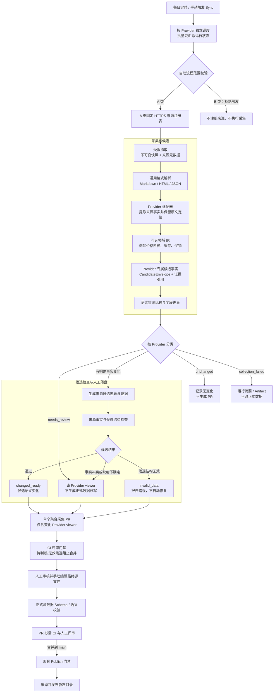

# PRD-INGEST-1 · 自动采集差异评审与 PR 工作流

> 状态：🚧 进行中（采集、候选聚合与 PR 创建已实施；必需 CI 状态保护和部分 PR 生命周期分支未完成端到端验收）
> 依赖：[`ingestion.md`](../../guides/ingestion.md)、[`operations.md`](../../guides/operations.md)、[`PRD-DATA-3`](【已完成】PRD-DATA-3-规范模型注册表与Provider供应映射_cn.md)、[`ADR 0026`](../../adr/0026-采集快照与人工最终数据分离.md)

## 1. 背景

当前采集器能够从登记的官方来源生成候选并比较语义变化；部分 Provider 适配器还支持把候选转换成正式源数据。但采集、结果分类、候选决定和创建 PR 尚未形成统一自动流程，维护者需要手工运行命令并整理评审材料。目标工作流将采集观察与最终数据分开：采集器只比较自身来源快照，候选变化进入 PR；最终目录由维护者直接编辑并经 PR 审核。

首版自动采集只覆盖 [`provider-classes.md`](../../data/provider-classes.md) 名单中的 A 类 Provider；支持 GitHub Actions 手动触发和每日 UTC 00:00 定时采集。B 类 Provider 不建设采集器，也不纳入任何采集触发。每次运行区分无变化、来源候选变化、待判断数据异常、候选无效和采集故障；单个 Provider 失败不阻断其他 Provider。所有有待评审变化的 Provider 汇总到**一个聚合 PR**，每个变化 Provider 在 PR 中关联自己的 `viewer.md`，无变化 Provider 不生成或关联报告。采集器不改写最终数据；维护者在 PR 中人工决定是否及如何更新正式源文件，最终数据仍须通过仓库校验并合并到 `main` 后才能进入现有发布流程。

## 2. 目标

1. 支持维护者手动触发单个 A 类 Provider 或全部合格 A 类 Provider，并按每日 UTC 00:00 定时运行 A 类；两种触发复用同一套解析、比较、候选生成和 PR 流程。
2. 所有 Provider 的变化进入单个聚合 PR；每个有变化的 Provider 有独立 `viewer.md` 报告链接。抓取时间、响应排版、字段顺序和未变化字段不进入变化报告。
3. 对采集异常、数据异常和无法判定项给出明确分类与后续处理状态，避免将错误或不完整结果作为无变化或正式数据。
4. 让自动生成的评审 PR 成为人工处理入口；合并数据 PR 可记录候选接受决定，不要求维护者另行运行候选接受命令。
5. 使 PR 可追溯到来源、快照、候选指纹、字段差异和校验结果，并且重复运行不会生成重复 PR。
6. 保持公开数据静态发布、CI 只读、Publish 为唯一生产写入通道的现有边界。
7. 在确有复用价值时允许使用局部领域 IR，但保留 Provider 专属事实、市场边界与证据；IR 只辅助候选和评审，正式数据由人工编辑并遵循 ProviderList 契约。
8. 将采集器、来源登记、单 Provider 手动触发、批量触发与定时触发统一限制为 A 类 Provider；B 类不保留采集器或采集入口。
9. 接入快照差异与候选 PR 工作流时，不改变 Provider API、Route、Provider/Service 能力或 Plan 套餐的采集来源、解析范围和字段语义；DATA-3 对模型详情及价格采集的调整不扩展为其他采集器重写。

## 3. 非目标

- 不自动批准、合并或发布采集 PR。
- 不因单次来源缺席、抓取失败、分页不完整或解析异常而删除数据或自动退役模型。
- 不允许工作流从候选内容获取任意 URL、执行采集到的代码，或绕过固定来源登记。
- 不更改 ProviderList 公开 Schema、价格语义、模型类型或生命周期规则。
- 不因接入自动 PR 工作流而改变既有 API、Route、Provider/Service 能力、Plan 套餐及套餐价格采集器的来源与解析行为。
- 不把 models.dev v2 当作 ProviderList 的中间或正式数据契约；可复用其通用采集/转换思路，不导入其数据模型来替代本站契约。
- 不要求适配器自动转换或写入最终数据；所有适配器的机器 PR 都是候选变化与来源证据，正式目录更新由人工审核者完成。
- 不为 B 类 Provider 建设、维护或触发采集器；需要支持时必须先调整分类，将 Provider 纳入 A 类。
- 不把采集写权限加入只读 CI。手动与定时采集由独立 Sync workflow 触发，使用创建或更新 Provider 专属分支及 PR 所需的最小权限。
- 本 PRD 的人工评审指数据内容 PR 评审。现有 `production` 环境部署审批属于发布门禁，不在本需求范围内。

## 4. 用户与使用场景

| 用户 | 场景 | 期望结果 |
|---|---|---|
| 数据维护者 | 手动触发单个 A 类 Provider 或全部合格 A 类 Provider | 看到每个 Provider 的运行状态；有变化的 Provider 汇总到同一个 PR，并保留各自独立的 viewer |
| 数据维护者 | 需要更新 B 类 Provider 数据 | 先经分类决策将 Provider 纳入 A 类，再建设并触发专属采集器 |
| 数据维护者 | 采集结果与人工维护文件发生冲突 | 自动流程停止覆盖并清楚报告冲突 |
| 数据维护者 | 采集到相互冲突或无法映射的数据 | 收到仅供判断的评审项，不混入正式数据变更 |
| 仓库维护者 | 临时验证某个 Provider 或重新运行失败流程 | 可手动重跑；失败、异常、无变化和可评审变化能清楚区分 |
| PR 审阅者 | 审核自动生成的数据变更 | 能从差异定位到来源、适用条件和数据校验结果，并知道该 PR 是否可合并 |

## 5. 工作流要求

### 5.1 触发与范围

- 支持通过独立 Sync workflow 的 `workflow_dispatch` 手动触发；可指定单个 A 类 Provider 或运行全部合格 A 类 Provider。单 Provider 和批量运行使用相同的执行逻辑。
- 支持每日定时触发一次，计划时间为 UTC 00:00，且只调度 A 类 Provider；手动触发与定时触发使用相同的解析、分类、候选校验和 PR 幂等更新逻辑。
- 自动流程在调度前依据 `docs/data/provider-classes.md` 校验分类；B 类 Provider 必须被排除在定时和批量任务之外。B 类 Provider 不得有采集器或单 Provider 触发入口；调整分类纳入 A 类后方可建设采集器。
- 现有 CI 保持 `contents: read`，不负责抓取、提交、创建分支或操作 PR。Sync 使用独立 workflow 与最小必要的仓库权限，不持有生产部署凭据。
- 仅处理代码中登记的来源和明确启用的 Provider 适配器。
- 单个 Provider 的失败不得阻止其他 Provider 的独立采集结果被报告。
- 同一 Provider 的专属分支不得有并行写入任务；同 Provider 的手动与定时任务冲突时应串行或取消旧任务。不同 Provider 可独立运行，一个 Provider 的失败、取消或重试不得阻塞其他 Provider。

### 5.2 采集结果分类状态机

每个 Provider 独立进入以下运行状态；批量运行汇总各 Provider 状态，不以单项失败覆盖其他项的结果：

| 状态 | 判定条件 | 后续动作 |
|---|---|---|
| `unchanged` 无变化 | 来源采集完整成功，语义事实与基线一致 | 正常结束，不创建提交或 PR |
| `changed_ready` 有可评审变化 | 来源完整成功，候选相对该来源最近一次成功观察发生语义变化，候选本身通过适用校验 | 在聚合 PR 中创建或更新该 Provider viewer |
| `needs_review` 数据待判断 | 来源事实可保留，但来源相互冲突、字段映射不确定、候选内部冲突，或数据异常需要人判断 | 在聚合 PR 的对应 Provider viewer 标出待判断；不写正式 Provider 或生命周期文件 |
| `invalid_data` 数据校验失败 | 候选可生成，但候选结构或事实校验未通过 | 在聚合 PR 的对应 Provider viewer 列出校验错误；CI 门禁阻止合并，不生成最终数据改写，也不自动修正后继续 |
| `collection_failed` 采集失败 | 超时、限流、HTTP 错误、来源缺失、分页不完整、解析结构异常或无法生成可信候选 | 本次停止该 Provider；在运行摘要和 Artifact 中报告失败与来源，不创建数据 PR、不清空正式数据 |

- 只有 `changed_ready`、`needs_review` 和 `invalid_data` 可因来源语义变化更新聚合 PR 中的 Provider viewer。`needs_review` 和 `invalid_data` 必须显著标为待判断，并由必需状态检查阻止合并；不得含采集器生成的最终目录改写。
- 候选为空本身不能证明供应为空。只有适配器明确确认来源完整且空结果符合来源契约时，才可按其规则分类；否则为 `collection_failed` 或 `needs_review`。
- 运行摘要须列出状态、Provider、候选指纹（若有）、失败/待判断原因、来源快照引用和后续处理方式。原始快照作为 Workflow Artifact 保留，不提交到 Git 历史。

### 5.3 变化判断与候选

- 以稳定语义指纹判断事实是否变化；原始内容哈希仅用于证据追溯。唯一比较基线是**同一采集来源的最近一次完整成功观察**。
- 不读取最终数据、公开编译结果或页面展示结果来决定采集变化。为校验 ID 映射或识别待建 Issue，可按只读方式查询 Model 注册表；此查询不参与快照差异计算。最终数据的人工修改不改变采集器基线，不单独触发采集 PR。
- Model 身份查询读取由 `data/models/<developer_id>/<model>.json` 编译汇总的规范注册表；采集差异、快照基线和候选报告不得以这些人工维护文件或 `/v1/models.json` 作为比较基线，也不得自动修改单型号文件。
- 首次完整成功观察建立该来源基线并生成可审阅差异；后续语义指纹相同则不生成新评审项或 PR。只有完整成功观察可推进基线。
- 只有来源采集完整成功时才允许判定 `unchanged`；来源失败、不完整或解析结构异常时必须标记 `collection_failed`，不得将其解释为供应清空或无变化。
- 对 IR 中明确标为 `model_catalog=complete` 的相同市场目录，跨运行跟踪 Provider Offering 缺席；完整目录连续缺失达到 2 次且观测跨度至少 24 小时时，将 Provider 状态归为 `needs_review`，并在 viewer 中建议将对应 Offering 的生命周期标为 `unknown`。不完整目录打断连续计数，采集失败不推进计数。
- 对于格式有效但语义异常、来源互相矛盾或映射无法确定的候选，必须标记 `needs_review` 或 `invalid_data`，不得静默丢弃、自动修正或转换为正式数据。
- 候选保留 Provider 专属事实结构、来源引用和快照引用；不得因跨适配器统一而丢弃来源语义。

### 5.4 正式数据转换与保护

- 自动流程仅写入其拥有的快照元数据、候选差异、证据和评审报告；不得自动生成、重写或覆盖最终 Model、Provider 或生命周期源文件，也不得写 `dist/v1/`。
- 需要更新正式源数据时，由维护者在候选 PR 中手动编辑，并提供接受、修正或排除候选的依据；正式源文件仍通过现有 Schema 与语义校验。
- 采集器不读取正式文件来建立/更新自身基线，不以最终文件与候选不一致作为机器冲突。候选与最终值不同由人工评审决定，不会触发自动覆盖。
- 单次缺席只能形成待核实观察；任何自动转换均不得仅凭缺席生成退役结论。

### 5.5 聚合采集 PR 与 Provider 报告

- A 类 Provider 的变更统一汇总到单个自动采集 PR；一个 Provider 的采集失败不阻断其他 Provider。B 类不进入定时或批量流程。
- 聚合 PR 仅纳入存在待评审语义变化的 Provider。PR 中逐个链接对应的 `data/candidates/<provider-id>/viewer.md`；无变化、未运行或仅采集失败且无可信候选的 Provider 不生成或关联 viewer。
- 每份 viewer 是该 Provider 的独立报告，只列相对来源基线实际新增、修改及待核实缺席字段的路径、新旧值、适用条件和来源证据；不输出未变化字段整行、整对象或完整快照。多个 Provider 的变化不得混在同一张字段差异表中。
- PR 正文提供变化 Provider 清单、viewer 链接、整体校验结果及人工审核要点；不重复复制各 Provider 的完整差异表。运行状态的完整清单（包括 unchanged 与 collection_failed）放在 Workflow Summary；失败项不得伪装成无变化。
- 原始响应快照和完整候选 JSON 不提交到 PR 分支，作为 Workflow Artifact 保留 90 天；viewer Markdown 与候选指纹、来源 URL、内容哈希及观察时间一起进入聚合 PR。
- 每次运行复用同一个聚合分支和同一个未完成 PR；后续运行更新尚未处理的变化，不按 Provider 创建多 PR，也不制造空提交。候选状态基线单独持久化，不参与人工评审 diff。
- `needs_review` 和 `invalid_data` 在聚合 PR 中显著标注；CI 的 `verify` 门禁会失败。仓库须将 `verify` 配置为 `main` 的必需状态检查，GitHub 才会阻止合并；该仓库级规则需在 GitHub 设置中确认。`collection_failed` 仅进入 Workflow Summary/Artifact，不因此创建空 viewer 或阻断其他 Provider。
- 达到连续完整目录缺席阈值的 Offering 在 viewer 中给出待核实状态建议和每次来源观察时间；该提示阻止候选自动转为正式数据，PR 由维护者决定是否修改 Offering 生命周期。
- 审核者可以在聚合 PR 中手动编辑正式源数据；自动采集器只拥有 viewer 报告，不得提交 `data/providers/`、`data/models/`、生命周期文件或 `dist/v1/`。
- PR 生命周期按候选哈希分别追踪；`open`、`updated`、合并结果、`closed_unmerged`、`superseded` 不因聚合 PR 而丢失 Provider 维度。未合并关闭不自动视作拒绝，合并也不自动视作候选字段已经进入正式数据。
- 使用统一聚合 PR 模板；报告保留 Provider 专属事实结构与证据，但摘要、新旧值、来源和人工审核顺序一致。

### 5.6 人工评审与候选决定

- 聚合采集 PR 中由审核者编辑的正式数据变更必须经过仓库要求的人工评审和必需 CI 检查后才能合并。仅含候选差异的 PR 也必须经人工审阅；待判断或无效候选不得因 PR 合并而自动写入正式数据。
- 候选 `accepted` / `rejected` / `superseded` 必须有可追溯的决定。聚合 PR 合并且当前 head 有人工批准时，自动记录候选 `accepted`；这只表示候选已处理，不代表字段已进入最终目录。不得将合并执行者直接等同于审阅者。明确拒绝仍由维护者记录；新观察取代旧候选时记录 `superseded`。一个 Provider 的处理不得改变其他 Provider 的候选状态。
- 未合并关闭的 PR 记为 `closed_unmerged`，不得仅凭关闭动作推断为 `rejected`；明确拒绝时才记录 `rejected`。被新候选取代时记录 `superseded`。决定记录须可追溯到 PR、候选哈希和触发依据。
- PR 审核不代表生产发布；只有合并到 `main` 后，现有 Publish 门禁才可构建和部署。

### 5.7 总体架构图

下图描述从来源采集到发布的职责边界。通用解析器负责复用格式处理；Provider 适配器负责来源语义、候选事实和证据。领域 IR 是可选的局部归一化层，不能取代 Provider 专属候选，也不作为另一套公开数据契约。机器不转换或写入最终数据；审核者人工编辑的正式文件须符合 ProviderList Schema。

- `needs_review` 表示候选事实可保留，但其含义、来源冲突或映射需要人判断；`invalid_data` 表示候选结构或事实校验失败。两者都不得由机器写入正式数据；对应 viewer 标明问题，并由 CI 门禁阻止未处理候选合并。
- 所有 Provider 共用一个未完成聚合 PR；机器只提交发生变化的 Provider viewer。正式源文件仅由审核者在 PR 中手动编辑，之后由现有 CI 校验。批量运行的状态汇总留在 Workflow Summary/Artifact；若某 Provider 只有采集失败，则只记录运行结果，不创建该 Provider viewer。
- 原始快照通过快照存储/Artifact 和 hash 引用追溯，不提交原始响应正文到 Git；来源观察基线不从最终数据反推。合并后的正式源数据仍由现有 CI 与 Publish 流程处理。

## 6. 验收标准

- [x] 维护者可通过独立 Sync workflow 手动触发单个 A 类 Provider 或全部 A 类 Provider；定时任务每天 UTC 00:00 只调度 A 类；两种触发使用相同逻辑，现有 CI 仍只读，不获得采集或 PR 写权限。
- [x] 调度范围严格按 `docs/data/provider-classes.md` 的 A 类名单过滤；定时、批量与单 Provider 触发均拒绝 B 类。B 类没有采集器、来源登记或触发入口；需先纳入 A 类后再建设采集器。（`scripts/ci/resolve-ingestion-providers.mjs` 直接解析 `docs/data/provider-classes.md` 的 A 类小节；`schedule` 与 `scope=all` 只取 A 类名单，`scope=provider` 只允许 A 类；端到端用例验证定时、批量与单 Provider 手动运行均只接受 A 类。）
- [x] 对无变化且采集完整的 Provider 运行两次，第二次与该来源最近一次成功观察比较后状态为 `unchanged`，不生成重复候选评审项、提交或 PR。（实跑 `deepseek` 连续三次：状态恒为 `unchanged`，语义指纹 `sha256:e7a85e7d…3c0b0f` 三次一致，评审文本逐字节相同，未产出 viewer，正式数据未改动。）
- [x] 最终 Provider/Model 文件被人工修改但来源快照不变时，不因此生成候选 PR、基线冲突或覆盖修改。（在 `data/providers/deepseek.json` 临时增改 `aliases` 后重跑：人工改动原样保留、来源基线不变、状态仍为 `unchanged`、未产生基线冲突；验证后已还原该文件。）
- [x] 批量运行中至少两个 Provider 有语义变化时，自动流程更新一个聚合 PR，并分别关联各 Provider 的 viewer；每份 viewer 只含该 Provider 相对自身快照基线的差异和证据，不混淆 Provider 内容或自动改写最终数据。（端到端用例「聚合 PR：两个 Provider 变化合成一个 PR，各自 viewer 互不混淆」在临时 git 仓库内跑真实合并脚本验证：两个 Provider 合成一个 PR、各自 viewer 内容不交叉、正式数据未被改写。）
- [x] 每份 Provider 变化报告只包含该 Provider 本次运行的变化字段及新旧值，不输出无变化字段或未运行 Provider 的信息。（同上端到端用例校验 viewer 内容边界；实跑 `deepseek` 未变时评审文本逐字节不变、无新增报告。）
- [x] PR 正文为每个有实际变化或待人工判断且有可信候选的 Provider 提供中间评审 Markdown 链接；无变化 Provider 不提交或关联 viewer 文件，采集失败且无可信候选时不生成链接。（渲染器 `scripts/ci/render-ingestion-pr-body.mjs` 只为 `changed_ready` / `needs_review` / `invalid_data` 三种状态生成 viewer 链接，`unchanged` 与 `collection_failed` 不生成。）
- [x] 后续手动或定时运行复用同一聚合 PR；未决 Provider viewer 保留，新变化加入对应 viewer，未变化 Provider 不新增报告，不创建重复 PR。（聚合分支固定为 `automation/provider-ingest`，workflow 先查 `gh pr list --head automation/provider-ingest` 决定 `opened` / `updated` / `reopened`；合并脚本 `listPendingViewers()` 按内容哈希比对 `main`，保留仍待评审的既有 viewer。）
- [x] 来源相互冲突、映射不确定或数据异常时，结果为 `needs_review`；聚合 PR 对应 viewer 列明待判断材料，且机器生成部分不改写正式源文件、不误记候选接受。（端到端用例「needs_review 与 invalid_data 在 PR 正文显著标注并被门禁拦下」验证：PR 正文标注 `⚠️ 需人工判断`、门禁判定失败、正式文件不被改写。）
- [x] 模拟候选结构校验失败时，结果为 `invalid_data`，聚合 PR 对应 viewer 列出错误且 CI 评审门禁失败。（同上端到端用例：`invalid_data` 与 `needs_review` 同属门禁阻断状态 `BLOCKING_STATUSES`，PR 正文单独列出并注明「需人工判断后才能合并」。）
- [x] 模拟超时、限流、HTTP 错误、解析异常、空响应和不完整分页时，结果为 `collection_failed`；不得误判为 `unchanged`、不得清空正式数据或自动退役，并在运行摘要与 Artifact 中显示失败来源。（端到端用例「collection_failed 不会被伪装成无变化」；另有真实失败样本：`anthropic` 官方站对本机区域返回 307 跳转到 `app-unavailable-in-region`，跨主机重定向被安全规范拒绝，状态记为 `collection_failed`、候选基线自动回滚、正式数据未改动。）
- [x] 在候选 PR 中由审核者手动修改正式文件后重跑采集器，采集器基线仍只跟随来源快照；人工改动保持不变，不报告“正式文件与自动基线不一致”。（`deepseek` 人工改动后重跑验证：改动保留、来源基线不变、状态仍为 `unchanged`，未出现基线冲突记录。）
- [x] 由审核者编辑的正式源文件通过 `pnpm validate:data` 和目录构建；校验失败时 PR 不可合并。（带人工改动的 `data/providers/deepseek.json` 通过 `pnpm validate:data`（0 错 0 警）与 `pnpm build:catalog`；校验失败时 PR 不可合并的路径由端到端用例的门禁失败分支覆盖。）
- [ ] CI 对 PR 执行检查且不持有生产写权限；仓库将 `verify` 设为 `main` 必需状态检查；Sync 不部署生产、不自动合并 PR。（CI 已设 `permissions: contents: read`、Sync 工作流无部署与自动合并步骤，这两部分成立；但「`verify` 设为 `main` 必需状态检查」因仓库为私有且当前 GitHub 套餐不支持分支保护，`repos/Coffeiz/providerlist.dev/branches/main/protection` 返回 403「Upgrade to GitHub Pro or make this repository public to enable this feature」，该项需升级套餐或改公开仓库后才可落地。）
- [ ] 聚合 PR 打开、重开、更新、合并或关闭时按 Provider 与候选哈希记录生命周期；合并且当前 head 有人工批准后自动记为已接受，未合并关闭记为 `closed_unmerged` 而不自动标拒绝，被新候选取代时记录 `superseded`。接受只表示候选已处理，不代表字段已进入正式目录。（端到端用例「PR 生命周期：打开与更新按 Provider 与候选哈希分别记录」已覆盖 opened / updated 的写入；「合并且当前 head 有人工批准后记为已接受」「`closed_unmerged`」「`superseded`」三条分支依赖真实 PR 事件与 `gh api` 读取，尚未端到端验收。）
- [x] 原始响应快照不会进入提交历史；公开目录只由既有目录编译流程生成。（`data/upstream/snapshots/` 已在 `.gitignore`；`git ls-files` 与全量提交历史均无快照文件；公开目录仅由 `pnpm build:catalog` 生成到 `dist/v1/**`。）
- [x] 所有适配器的机器生成 PR 都只更新采集器拥有的候选差异和证据，不以是否具备正式转换器为条件，不会被误报为已更新最终目录。（实跑采集与端到端用例均确认：机器侧只写 `data/candidates/**` 与 `data/ingestion-lifecycle/**`，正式目录 `data/providers/**`、`data/models/**` 未被自动改写。）
- [x] API、Route、Provider/Service 能力、Plan 套餐和套餐价格在接入 PR 工作流前后保持来源、解析范围、数据归属和语义不变；变化仅限候选差异及人工评审流程。（接入 PR 工作流后全仓测试、数据校验与目录编译结果不变，采集链路只新增 `data/candidates/**` 与评审产物，不触碰正式目录的字段语义。）
- [x] 若采用领域 IR，金额保持十进制字符串，市场、适用条件、字段证据和来源定位可追溯；IR 不丢弃 Provider 专属事实，最终产物通过 ProviderList Schema 与语义校验。（本仓库未引入跨 Provider 的领域 IR，采集层按 Provider 适配器直出候选（`pipeline/src/ingest/`），该条件分支不适用；金额在 `packages/shared/pricing` 以 `DecimalString` 十进制字符串保真，市场（`market`）与字段级证据随候选记录，最终产物仍经 `pnpm validate:data` 校验。）

## 7. 影响的契约

- **公开 Schema 与公开 JSON：** 不新增字段或改变契约；被审阅并合并的正式源数据变化会按现有流程反映到编译产物。
- **候选与决定记录：** 明确采集运行分类、单个聚合 PR 与 Provider 候选决定的映射；聚合报告仍按 Provider 隔离候选身份。
- **变化基线与最终事实：** 每个来源的完整成功观察和语义指纹属于采集器状态；该基线独立于人工维护的最终数据，自动工作流不得通过最终目录反推来源变化。
- **CI 与发布：** 增加独立 Sync workflow，支持手动触发及每日 UTC 00:00 定时触发。CI 仍只读，Publish 仍是唯一生产写入通道。
- **采集范围与分类：** 自动采集范围以 `docs/data/provider-classes.md` 的 A 类名单为准；实现时同步更新该文档和 `docs/guides/ingestion.md`，明确仅 A 类建设与维护采集器，B 类不配置采集器的边界。分类仍不代表可信等级或供应事实。
- **命令与目录：** 若增加统一 Sync 命令或新的 GitHub 工作流，须同步更新 `docs/guides/ingestion.md`、`docs/guides/operations.md` 和仓库 `README_cn.md` 中对应的命令/目录说明。
- **信任边界：** 来源身份不等于内容正确；自动生成的字段仍是待审候选，不能据此声称 API 实测成功或官方授权。

## 8. 风险与缓解

| 风险 | 缓解 |
|---|---|
| 采集器缺陷造成大量无意义 PR | 使用语义指纹去重；聚合 PR 只列实际变化的 Provider viewer；解析不完整时停止对应 Provider 的转换 |
| 采集失败被误判为无变化 | 只有采集完整成功才允许进入 `unchanged`；失败状态单独报告 |
| 错误或不确定数据进入正式目录 | 数据异常与运行失败分状态处理；仅完整且校验通过的候选可进入可合并数据 PR |
| 采集候选覆盖人工最终数据 | 采集器只写候选差异与来源证据，正式源文件由审核者手动编辑；变化基线独立存于来源观察 |
| 单次抓取缺席被误判为退役 | 仅记录待核实观察，遵循生命周期证据规则 |
| PR 缺少足够证据导致审核失效 | PR 强制列来源、快照哈希、字段路径、适用条件和检查结果 |
| 自动化凭据扩大写权限 | Sync 仅获得创建/更新分支与 PR 所需的最小权限；不授予生产部署凭据 |
| 多个 Provider 的候选或 PR 状态交叉影响 | 以 Provider、候选哈希分别追踪；聚合 PR 仅聚合链接，差异报告、状态与决定仍按 Provider 隔离 |
| 候选自动转换被误解为已验证 | 明示“待审”；只有正式证据与既有核验流程可提升字段核验状态 |
