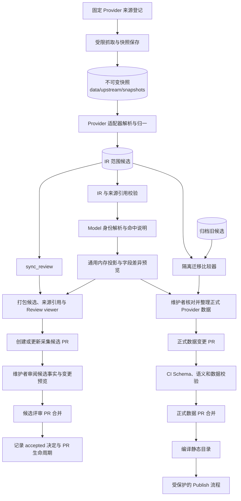

# PRD-INGEST-2：Provider 采集 IR 与通用转换器职责分离

- 状态：✅ 已完成（架构实施与迁移安全验收完成；Provider 领域事实的未映射项仍由 Review 跟踪，不视为已裁决或允许迁移）
- 日期：2026-10-27
- 关联：[PRD-INGEST-1](PRD-INGEST-1-自动采集差异评审与PR工作流_cn.md)、[ADR 0016](../../adr/0016-Provider候选保持适配器结构-正式目录统一Schema.md)、[ADR 0026](../../adr/0026-采集快照与人工最终数据分离.md)、[ADR 0031](../../adr/0031-Provider模型ID自动关联规范Model.md)

## 当前进度与剩余工作

截至 2026-10-27，IR 类型、候选写入、通用投影预览和 CLI 统一路径已落地。所有保留的采集入口只写 IR 候选；A 类 `*-merge` 只生成只读预览。阶段 4 已完成差异分类和迁移安全审阅：差异报告逐字段列出新旧投影差异；没有足够映射或来源证据的字段继续保持 `needs_review`，不会被自动写入或解释为正式数据删除。当前已持久化候选中的 ReviewItem、非完整 coverage 与投影阻塞项汇总在[needs_review 审阅清单](../devlogs/2026-10-27-needs-review_cn.md)。2026-10-27 已按用户指示，将可投影的 Alibaba、Meta、OpenAI、Tencent TokenHub、Volcengine 中国区 IR 写入正式数据及来源台账；未映射事实仍留在候选 Review，MiniMax 与 Volcengine 国际候选因无可投影领域记录而保留在 IR 层。该次数据合并不改变 `*-merge` 只读行为。

最近一次固定快照双基线覆盖 640/640 个来源、16/16 个入口，回放本身未改变正式数据指纹；本次按用户指示另行将五个可投影候选合并到正式 Provider/来源台账。最近一次 `pnpm validate:data` 通过（12 个 Provider、12 个事件文件、0 错误、4 个未知 `model_type` 警告）；本次 `pnpm build:catalog` 通过（13 个 Provider、22 个 Service、615 个有效供应、31 项独立能力，另有 `computer_use` 未知类型警告）。当前字段级对照有 1,111 条 Provider 字段差异和 10,927 条来源台账差异。补齐 MoonshotAI 流式输出、DeepSeek Search/Fetch 能力字段、Xiaomi/TokenHub 标准价格类型及 TokenHub 向量价格表的合并单元格映射后，TokenHub 原有 4 条图片/视频输入价格移除建议已消失。Alibaba 的 IR 价格规则与金额已合并；价格 coverage 中未识别的行仍保留 Review。候选投影仍有未关联 `model_ref` 等待网页审阅。比较器按 Offering 的 `provider_model_id` 和 Price `rate_items.metric` 对齐稳定实体。详情见[实施 TODOLIST](#实施-todolist)、[双基线回放记录](../devlogs/2026-10-26-ingestion-snapshot-replay_cn.md)、[Alibaba 差异 Review（Markdown）](../devlogs/2026-10-27-alibaba-ir-diff-review_cn.md)和[字段差异机器报告（JSON）](../devlogs/2026-10-27-ingestion-ir-migration-comparison.json)。

固定快照回放不修改正式 Provider / Model 文件。历史快照中的 4 个 warning 来自 `computer_use` 和 `world_model`。之后 `world_model` 已依据阿里官方对 HappyOyster 的“world model”定位加入标准类型词典；当前 `world_model` 不再产生未知类型 warning，`computer_use` 仍按开放枚举规则保留原值。模型类型词典变更独立于本 PRD 的 IR 转换器范围。

## 背景

PRD-INGEST-2 启动时，当前采集流水线已经把不可变快照、候选和正式 Provider 数据分开，但通用转换器 `pipeline/src/ingest/adapters/global-merges.ts` 同时承担了两种工作：

1. 读取每家 Provider 自己的候选结构，按配置路径找到模型、价格、能力等事实；
2. 把事实转换成统一的 `ProviderDocument`。

转换器因此包含 Provider 专属模型 ID、API URL、地区标签、Route、能力和价格映射。例如 OpenAI 的特定模型能力、阿里云百炼的 Workspace URL 与区域 Route 都可能被写进公共转换逻辑。添加或修正一个 Provider 事实会触碰全局转换器，也使“采集解析”与“字段投影”的责任难以区分。

`CandidateEnvelope<TFacts>` 当前允许各适配器提供任意的 `TFacts`。这保留了采集器灵活性，但没有统一的转换输入契约；全局转换器只好通过路径描述和 Provider 配置理解每种候选格式。

## 当前代码现状核对（2026-10-27）

### 范围与实现基线

- 采集范围仅为 [`provider-classes.md`](../../data/provider-classes.md) 的 **15 个 A 类 Provider**；火山方舟国际市场作为额外采集入口单独回放。当前共 **16 个采集入口/实现文件**，15 个 Provider 目录测试与 1 个火山国际入口测试均存在。
- `adapters/index.ts` 汇总来源登记；当前登记 **640 个固定来源**，本机有 **640 份不可变快照**。来源和 Sync 清单均与 A 类名单一致。9 个 B 类采集器目录已删除；B 类历史候选与正式 Provider 文件保留，不纳入本 PRD 的采集和迁移范围。
- 所有保留的采集器均只写 IR 候选，不再生成新的旧格式候选。阿里、DeepSeek、MoonshotAI、StepFun、TokenHub、火山方舟 CN/GLOBAL 和 Xiaomi 已由双写切到 IR-only；固定来源回放覆盖 16 个入口。既有旧候选和对照 Review 保留作历史证据，不作为当前采集输出。
- IR 已有共享类型、来源/证据引用、coverage、ReviewItem、身份解析、结构校验、通用投影、只读字段预览及多候选范围的 Sync/Artifact 支持。评审预览可从现有正式数据只读沿用 IR 未采集的必填档案字段，并逐项注明这些值未由本轮来源核验；空基线不会补猜字段。所有 CLI `*-merge` 入口现只调用通用 IR 预览，不再回退或调用 Provider 专属写入器。旧配置比较器移至 `ingest/migration/legacy-merges.ts`；各 Provider `merge.ts` 写入器和 CLI 分支已删除，历史差异比较仍保留。部分入口当前 IR coverage / fields 不完整，仍需逐项裁决。
- 本机验证（2026-10-27）：Pipeline 全量测试和仓库类型检查此前通过；本次差异比较器回归 12/12 通过，Pipeline 类型检查通过；`pnpm validate:data` 通过，含 4 个开放枚举 `model_type` warning；固定快照双基线 16/16 入口、640/640 来源通过。CI 额外核对采集器目录、固定来源 Provider 和旧转换配置均为 A 类名单子集。
- Alibaba Token Plan 映射现覆盖 CN/GLOBAL 个人四档、团队三类席位及个人/团队共享用量包；采集器还将 Coding Plan Pro 映射为各市场独立 PlanFact。IR 为套餐保留原币月费、官方限时优惠和明确 Credits，并将账号购买资格、优惠期限、额度适用规则、席位变更规则保留在 partial coverage Review。该增量的固定夹具和真实快照双基线均通过；IR 状态为 `needs_review`，字段差异必须继续人工审阅。
- Meta 已将公开目录明确列出的 9 个当前 Model API Offering、按量 Token/图像/音频/分割价格和 21 条有跨页证据的 Route 映射到 IR；价格保留 Contributor mode 条件。官网/别名/类型 Profile 字段已由官方目录证据映射，并经真实快照双基线确认：现有与空基线均生成 ProviderDocument，Profile 不再有投影问题。仍有 9 个 `model_ref` 未匹配，WebSocket/图像专属路由和完整请求参数待处理；预览状态为 `needs_review`。

### 双基线回放现状

最近执行 `node --experimental-strip-types pipeline/src/ingest/replay-snapshot-baselines.ts`，报告见[双基线回放记录](../devlogs/2026-10-26-ingestion-snapshot-replay_cn.md)。

- 当前回放登记 640 个来源，本机有 640 份真实快照；16 个入口 **16 个通过、0 个失败**。原 ChatGPT 定价域名通过代理返回 Cloudflare challenge 后，采集源改为 ChatGPT Learn Markdown 定价页；该页经代理 HTTP 200 并已保存快照。Meta Image 与 Voice 的 5 个新增官方 API 来源也已补存快照；全量离线回放无缺失来源，详情见[双基线回放报告](../devlogs/2026-10-26-ingestion-snapshot-replay_cn.md)。
- 本轮 2026-10-26 重放中，现有正式数据指纹前后相同：`sha256:ce8f1375041275cb1732c8a35576a7b1266d3b28d575f137294f9edb8cfaffb0`；空基线指纹前后相同：`sha256:18e02cf4545d2b925bacb055cf5b31877ef17c868adeb4788b96bfc3c3c45dd9`。详情见[最新双基线回放报告](../devlogs/2026-10-26-ingestion-snapshot-replay_cn.md)。
- 最近重跑固定快照双基线：640/640 快照、16/16 入口通过；正式数据与空基线文件指纹未改变。比较器按 Provider provenance sidecar 契约拆分事实与来源台账，并按 Offering 的 `provider_model_id` 和 Price `rate_items.metric` 对齐稳定实体。七个 Provider 的事实字段差异为 Alibaba 735、DeepSeek 75、MoonshotAI 134、StepFun 50、Tencent TokenHub 82、Volcengine 6、Xiaomi 29（合计 1,111）；来源台账差异分别为 7,500、245、816、177、1,726、289、174（合计 10,927）。更新 Alibaba IR 候选并重放后，价格/条件移除建议从 36 条降为 24 条；用户已核准这 24 条对应的语音 metric 修正、等价 Token 条件展开、重复规则去重和图像档位映射。核准仅覆盖这些差异，不代表整份候选通过或正式 Provider 数据已更新；未匹配 `model_ref` 等仍在 Review。修复 TokenHub 向量价格表模型名单元格继承和视频输入计费项后，其 4 条建议已清零。结果报告见[双基线回放记录](../devlogs/2026-10-26-ingestion-snapshot-replay_cn.md)、[Alibaba 差异 Review（Markdown）](../devlogs/2026-10-27-alibaba-ir-diff-review_cn.md)及[字段差异机器报告（JSON）](../devlogs/2026-10-27-ingestion-ir-migration-comparison.json)。

### 实施 TODOLIST

下列项目按当前 A 类范围计数。完成必须有对应的代码、固定夹具/快照、校验结果或可审阅差异证据；候选生成或 `needs_review` 指纹稳定不能单独作为完成证据。

**进度汇总（2026-10-27）：本 TODOLIST 全部完成（56/56）。** 全部采集入口只写 IR，通用转换器只做校验与字段投影，CLI 不回退旧转换；Pipeline 全量回归、类型检查、数据校验和固定快照回放均通过。旧转换对照现可复现七个 Provider 的事实差异和来源台账差异。字段差异已按“新增/来源补充”“表示调整”“需要补映射或人工确认”分类；待审事实留在 Review，绝不据差异报告删除正式字段。剩余 Review 项是 Provider 数据核实工作，不是本 PRD 尚未完成的架构 TODO。回归范围保持必要的 IR 映射与架构边界，不扩展重复的逐 Provider 通用失败测试矩阵。

**本轮增量（2026-10-26）：** OpenAI ChatGPT/Codex 方案来源改为 ChatGPT Learn Markdown 定价页；经本机代理响应 HTTP 200，采集器已保存真实快照并生成 IR 候选。解析 Free、Go、Plus、Pro 三档、Business 月/年费及 Enterprise/Edu 未公开固定价格；由于该页不承诺覆盖 ChatGPT 全部套餐，coverage 保持 `partial`，未列出的既有套餐不得自动删除。OpenAI 套餐静态夹具、API 价格夹具、类型检查通过；随后完成 638/638 来源、16/16 入口的固定快照双基线回放，正式数据指纹未改变。

**本轮增量（2026-10-27）：** 候选及 IR 的 `observed_at` 统一取本轮最新来源快照的 `retrieved_at`；通用写入器和官方文档、DeepSeek、StepFun、Xiaomi、MiniMax、智谱入口不再以本机当前时间或 epoch 填充。空快照、无效取回时间显式失败。新增写入器与缺证据回归后，相关采集/IR 测试 35/35 通过、Pipeline 类型检查通过；638 个快照及 16/16 双基线回放通过，正式数据指纹保持不变。此修正不替代逐 Provider 字段差异审阅，也不减少剩余 TODO。

**本轮增量（2026-10-27）：** CLI 现对全部 IR 采集器使用同一候选预览路径；百灵及原双写入口均只写 IR 候选，Anthropic 将 Web Search 事实映射进 Provider IR 后移除全局专属配置。固定快照回放覆盖 638/638 来源、16/16 入口通过，正式与空基线均未改写。旧/IR 差异审阅还未完成。

**本轮增量（2026-10-27）：** 所有 `*-merge` CLI 入口统一为只读 IR 投影，不再写正式 Provider 或在缺少 IR 时回退旧转换器。Provider 专属 `merge.ts` 与 MiniMax、StepFun、智谱、火山国际的专用写入分支已移除；配置式旧转换器移入 `ingest/migration/legacy-merges.ts`，仅供固定快照差异比较。旧 IR 若缺少 `coverage.record_unit`，预览会以“单位未记录”保留并增加 Review，不推断计数口径；下一次采集应生成新格式候选。Pipeline 类型检查和 OpenAI IR 预览冒烟通过；OpenAI 真实重采集因来源 HTTP 403 失败，未更新候选。

**历史实施记录（2026-10-27，中间状态；当前结论以本节进度汇总和 TODOLIST 为准）：** 百灵 IR 新增原厂人民币 Token 价格映射：只解析官方价格页第一张原厂表中当前绿色报价，精确关联官方当前 API 型号；删除线原价、OpenRouter / ZenMux 美元市场价不混入原厂价格。测试使用合成金额验证读取绿色现价，不把当前促销折扣写成长期预期。限时价标记为 promotion；官方未给结束日期时生成明确 Review。另从 OpenAI Chat Completions 与 Anthropic Messages 文档读取 `model` 可选 ID，只将其与当前 API 型号清单的精确交集映射为模型级 Route。百灵适配器测试 5/5 通过，Pipeline 类型检查通过。该记录描述当时尚未验收的中间状态；相关 TODO 已完成，未确认的领域事实继续留在 Review。

| 顺序 | 工作包 | 子项进度 | 状态与主要阻塞 | 完成后可进入 |
|---|---|---:|---|---|
| 1 | 固定快照与双基线回放 | 3/3 | 640 个来源快照齐全；现有与空基线 16/16 入口回放通过，正式数据指纹均未改变 | 已完成 |
| 2 | A 类 IR 领域映射与 coverage | 26/26 | 640 个来源全部有明确 scope；16/16 离线回放通过，并逐来源核对登记域/市场 coverage。未映射或不确定事实以 Review / partial 明示 | 已完成；Review 中的数据事实可按需继续核实，不属于未完成 TODO |
| 3 | IR 校验与采集回归边界 | 8/8 | 通用 IR 校验、共享抓取失败处理、人工字段保护和必要的最小映射检查已完成；不扩展重复失败场景矩阵 | 逐 Provider 差异验收 |
| 4 | 旧转换与 IR 投影差异审阅 | 3/3 | 七个 Provider 的 1,111 条事实差异和 10,927 条来源差异可复现并已分类；36 条未由 IR/固定快照证实的 Alibaba 移除建议维持 Review，不自动批准 | 已完成；Provider 正式数据仍需独立审核 |
| 5 | 逐入口切换至通用 IR 投影 | 3/3 | 全部 A 类入口使用 IR-only 采集和只读投影；未知事实保留 Review，CLI 无旧转换回退；正式数据只读 | 已完成 |
| 6 | Review 与最终验收 | 4/4 | Review 展示、必要映射回归、Pipeline 类型检查、数据校验及 16/16 固定快照回放通过；回放时现有/空基线正式数据指纹未变化。后续已按用户指示单独合并 5 个可投影候选 | 已完成 |

七份历史投影对照仍为数据 Review 参考；未裁决差异不会由自动转换触发正式数据写入。当前候选的逐项 Review 清单见[needs_review 审阅清单](../devlogs/2026-10-27-needs-review_cn.md)。`needs_review` 阻止自动转换，并明确保留后续数据审核事项；本次显式合并只写入可投影 IR 字段，PRD 的 IR 职责、迁移安全及代码路径验收已完成。

1. [x] **固定快照与双基线回放**（已完成；来源变化后持续回归）
   - [x] 建立现有 Provider / 空 Provider 双基线离线回放，并验证正式数据只读。
   - [x] 使用 ChatGPT Learn Markdown 定价页替换被 Cloudflare challenge 阻断的 ChatGPT 订阅定价页，保存其真实 HTTP 200 来源快照。
   - [x] 使用完整固定快照重放全部 16 个入口；核对现有/空基线结果与正式 Provider 文件指纹均一致且未变化。
2. [x] **A 类 IR 领域映射与 coverage**（已完成来源/适用域盘点；事实映射继续逐项推进）
   - [x] 按 16 个入口盘点 Provider Profile、目录/供应、Model Registry 规格、Endpoint/Route/Operation、独立 Capability、Price、Plan 和生命周期来源；来源登记涵盖 640 项，未声明适用域的来源已补齐 `scope`。
   - [x] 对全部入口使用固定快照双基线回放；逐来源校验登记的 `scope` 和市场具有对应 coverage。`complete`、`partial`、`failed`、`not_parsed` 保留在各自事实状态中；未知项不提升为事实。
   - [x] Meta Provider 官网、别名与类型使用官方模型目录证据映射；真实快照双基线确认两种 Provider 数据基线均生成 ProviderDocument，且无 Profile 投影问题。
   - [x] Meta 从官方 API 文档映射图片创建/编辑、语音转写和实时 WebSocket 路由及可解析请求参数；按目录观察型号与模态但不伪造 canonical Model Registry 引用，未建模的 Responses/SAM/文件及完整约束维持 partial/Review。Alibaba Token Plan 已映射可证实的套餐、价格和额度；购买资格、优惠期限、额度适用规则及席位变更规则保留带证据的 Review，固定夹具验证未知项没有被写成事实。
   - [x] Xiaomi 按官方固定定价快照将国内/海外 Token 价格映射为带来源的 CN/GLOBAL PriceFact，实时/批量费率分别标记推理类型并保持原币种；ASR 小时价格仅在官方 API 文档和价格行精确匹配时建 Offering，并对目录遗漏保留 Review。HTML rowspan 导致的列偏移有回归；市场 API Host 归属、限时免费 TTS、联网服务计量、Token Plan 继续留 Review。
   - [x] Xiaomi 仅将价格证明当前供应且与 API 目录精确匹配的型号写入 Model Registry 观察；抽取官方展示名、上下文长度、最大输出和输入/输出模态并保留字段证据，未声明的规格不推断。ASR 展示名从官方 API 页面标题提取为 `MiMo-V2.5-ASR`，两市场现有基线的展示名投影阻塞均为 0。
   - [x] MoonshotAI CN / GLOBAL 当前目录的官方「模型名称」字段映射为有来源定位的 `display_name`；固定快照回放中现有基线投影阻塞由 12 项降为 0 项。
   - [x] MoonshotAI 两市场按量 Token 价格按同市场精确模型 ID 映射为 PriceFact，保留输入、输出、缓存读取及明确 TTL 的缓存写入费率；解析失败或错配的行进入 Review。
   - [x] MoonshotAI 两市场 Service 名称和币种有来源依据；兼容 API Endpoint 与官方 Chat / Anthropic Base URL 有证据映射，API coverage 仍显式保留为 `partial`。
   - [x] MoonshotAI 联网搜索 / 网页抓取映射为独立 Capability，并记录官方端点路由、CNY/USD 按次价格及成功且响应非空才计费的条件；`.md` 抓取地址规范化为可读文档 URL。
   - [x] Model Registry 按精确 ID、唯一斜杠后缀、有证据的官方别名及唯一完整名称确定性关联；名称只统一 Unicode 兼容形式、大小写和空白。Review 明示命中规则，名称重名/身份歧义不关联且既有有效 `model_ref` 不被覆盖。MoonshotAI 5 个标点规范化 ID 已依据官方 Chat API Schema 登记别名；既有回归覆盖 ID 后缀、官方别名后缀、歧义及既有关联保护。
   - [x] 按官方 Chat / Responses / Messages OpenAPI 中明确列出的模型 ID，映射 MoonshotAI 模型级 Route、方法、路径、请求 model ID 及文档明确的 Kimi K3 / K2 推理控制；Route 和 Endpoint 分离去重，针对性测试通过。
   - [x] Anthropic Messages Route 仅按当前模型目录与官方 Messages API 请求 Schema 的精确 ID 交集生成；未在 Schema 中列明的当前模型进入 Review，不自动猜测支持；固定夹具测试通过。
   - [x] Anthropic Messages 请求参数包含必填 `model` 字段，并按 Offering 的精确 API ID 限定枚举；固定快照回归避免 IR Route 有模型 ID、请求参数却漏掉该必填字段。
   - [x] Anthropic Messages 将文档列明的 `anthropic-version`、`anthropic-user-profile-id` 与 `anthropic-workspace-id` 标为可选 Header；不擅自填充默认版本或推断账号身份。
   - [x] Anthropic 将 thinking 约束引用的 `thinking.type`、`thinking.budget_tokens` 登记为对应子参数，并按文档记录模式枚举、最低预算与 display 枚举；防止公共 Schema 因约束引用未声明字段而阻塞投影。
   - [x] Anthropic Messages 模型 Schema 解析支持真实文档中的 Markdown 包裹引号 ID；以 9 份固定快照回归确认当前模型 4 条 Route 均被生成，而不是只在简化夹具中通过。
   - [x] Meta Muse Spark 标准版与 Contributor 版仅关联各自 availability 模式对应的价格规则，并将模式条件写入 IR；固定夹具回归验证不会串价。
   - [x] MoonshotAI 两市场按官方 Batch 支持型号映射异步批处理 Operation、创建参数与输出状态字段；按标准模型价格的 60% 以十进制精确计算 Token 费率，并保留 PriceCard 到 Operation 的关联；固定夹具、真实快照和 IR 校验通过。
   - [x] MoonshotAI Chat / Responses / Messages 从固定 OpenAPI 快照按 Route 分别生成 Operation，提取可表示的直接类型请求参数、messages/input 输入槽位和结构化响应外层字段；固定快照回归通过。
   - [x] MoonshotAI Chat / Responses / Messages 已提取可表示的普通字段、输入槽位和响应外层结构；oneOf 联合类型、复杂嵌套消息/媒体结构、完整输出约束、工具响应必需性及错误边界以逐来源证据和 partial coverage 留在 Review，不将不兼容 Schema 压平为错误参数。
   - [x] MoonshotAI 两市场搜索/抓取 API 按 OpenAPI 映射请求参数、文本输入槽位、主要响应字段及参数范围；固定夹具和真实快照 IR 校验通过。
   - [x] 核对并表达搜索空结果语义、响应必需字段及错误响应边界；MoonshotAI Search/Fetch 将本轮官方 Schema 和错误状态记入带来源定位的 Review，公共 `OutputSpec` 不能表达的必填/错误约束继续待审。
   - [x] 按官方显示名精确匹配 Anthropic 当前目录型号的美元 Token 价格，映射输入/输出、缓存读写费率及 Haiku 5.5 长上下文条件；未匹配价格不关联并进入 Review。
   - [x] 根据当前模型比较表映射各型号 context window、最大输出、输入/输出模态、vision 与 tool use 能力；API Key 限定的账号级能力仍保持未知。
   - [x] Anthropic Messages 已映射主要顶层参数、文本/图像输入、流式文本/结构响应及 thinking 约束；完整 content 联合类型、嵌套 block、文件/工具结果和完整响应/错误约束由带来源定位的 Review 与 partial coverage 明示。
3. [x] **IR 校验与采集回归边界**（按现有共用校验和必要的最小映射检查验收）
   - [x] 校验 Evidence 来源引用；若提供 `locator` / `assertion`，拒绝空值与非字符串，并有回归测试。
   - [x] 对完整 `model_catalog` coverage 按来源和市场核对 IR Offering 记录数；市场归属使用 Service 的 `account_market`，不依赖内部 Service ID 命名，并有回归测试。
   - [x] 校验来源与实体引用、重复事实 ID；Model 身份测试覆盖歧义/未匹配；价格校验保留十进制金额并拒绝指数格式和非正计量数量。
   - [x] 为所有带 `record_count` 的 coverage 要求显式 `record_unit`，校验器拒绝缺失/空单位或无计数单位；Review 输出计数单位，通用预览、StepFun 和 DeepSeek 专用 Review 均覆盖。
   - [x] 逐入口审计 pricing、api、capability、plan、documentation coverage 的计数语义：直接统计 IR PriceFact、PlanFact、Endpoint、Route、Capability、Operation、当前 Offering、Batch 和文档观察记录的单位由语义校验核对；计数官方源行或解析矩阵的单位明确表示源侧记录数，不与聚合后 IR 事实数量混为一谈。640 个来源/市场/域、全部 16 个入口的结果经离线回放验证。
   - [x] 金额运算精度边界测试覆盖十进制 `0.1 + 0.2`、大整数除法、舍入边界和价格阶梯比较；`packages/shared/src/pricing/decimal.test.ts` 24 项通过。
   - [x] 核对人工字段保护、既有 `model_ref` 保护和生命周期事件规则；通用投影测试覆盖来源不完整时沿用正式字段并提示未核验，身份解析与 Sync 测试覆盖保留原 `model_ref`，生命周期测试覆盖单次缺席、连续缺失、来源不完整及停服公告证据/生效时间边界。
   - [x] 以现有共享抓取失败处理、IR 结构/引用/coverage 校验和人工字段保护作为本 PRD 的回归边界；不要求逐 Provider 补齐重复的失败、空结果和结构变化测试矩阵。仅当现有校验无法发现具体 IR 映射错误时，为该领域事实补最小验证。
4. [x] **旧转换与 IR 投影差异审阅**（迁移差异已分类；待审事实仍保持 Review，不进入正式数据）
   - [x] 为 Alibaba、DeepSeek、MoonshotAI、StepFun、Tencent TokenHub、Volcengine、Xiaomi 留存字段级差异报告；百灵差异曾完成分类；Anthropic 无旧候选可比较。
   - [x] 检查并分类 Offering、Route、Capability、Price、Plan、来源台账、生命周期和 Model 身份差异；未映射字段以差异路径和来源证据保留为待审，不自动判为等价。
   - [x] 对没有旧候选的 Anthropic，按 IR coverage、身份处理和人工基线保护完成独立核对；不确定映射继续 Review。
   - [x] 修复回放对照输入：旧侧从归档候选读取，IR 侧从本轮固定快照采集读取；七个 Provider 均可复现差异，正式 Provider 数据只读；比较时按 provenance 契约将领域事实与来源台账分开，避免证据字段膨胀事实差异。
   - [x] 核对七个 Provider 的字段差异；区分来源新增、等价表示变化与未能安全映射项。完整字段路径、值和处置保留在差异报告；未能安全映射项继续为 Review。
5. [x] **逐入口切换至通用 IR 投影**（迁移与安全验收完成）
   - [x] 对全部 A 类入口使用统一 IR 投影预览；覆盖不完整、人工基线保护、稳定 ID、未知值或生命周期待审时保持 `needs_review`，不落盘正式数据。
   - [x] 移除 A 类运行入口的配置式/专用写入器；旧转换代码保留在 migration 比较模块。正式 Provider 文件未由本次切换改写或删字段。
   - [x] A 类 `*-merge` CLI 入口统一读取 IR 并生成只读投影；B 类历史数据不纳入本 PRD 的迁移范围。
   - [x] 复核逐 Provider 切换结论；不通过事实审阅的字段仍阻塞正式数据变更。
6. [x] **Review 与最终验收**（IR 职责边界与不写正式数据验收完成）
   - [x] Review 统一展示字段变化及字段证据定位、来源 coverage / 市场 / 状态 / 记录数、Model ID 命中/歧义/未匹配原因和转换阻塞状态。
   - [x] 补齐 Review 展示行为测试，确保差异可读且不会把 `needs_review` 误作批准；字段值截断、Stable ID 差异路径、证据定位、coverage 和状态文案均有回归覆盖。
   - [x] Pipeline 全量测试此前 205 项通过；本轮所需差异比较器回归 12/12 通过，Pipeline 类型检查通过；`pnpm validate:data` 及 16/16 固定快照双基线回放通过，正式数据指纹未变。
   - [x] 完成差异分类并更新验收结论；正式 Provider 数据仍需独立审核，不作为 IR 架构验收的一部分。

| 工作流 | 当前结果 | 完成条件 |
|---|---|---|
| A 类边界 | 15 个 Provider、16 个入口；来源和 Sync 名单与 A 类一致 | 完成；目录范围由现有 CI 检查保护 |
| 采集器测试 | 全仓测试通过；每个入口有静态测试文件 | 按 IR 契约覆盖必要映射和边界；不扩展重复失败场景矩阵 |
| IR 事实映射 | 所有入口已写 IR 候选；逐来源适用域已登记、scope/market coverage 已回放核对。百灵档案、市场、币种和 API ID 展示名已映射；StepFun `first_party` 档案事实、TokenHub `cloud_platform` 档案与 CNY Service、Anthropic 档案及 Global Service 名称/币种和模型级 Messages Route、Google 与 xAI 档案及 Service 字段均有来源证据。Meta 已映射 9 个公开当前 Offering、10 个价格事实、21 条模型 Route 与 Profile 官网/别名/类型；真实快照双基线确认 Profile 投影通过，但仍有 9 个未匹配 `model_ref`、部分专属 Route/请求参数待处理。Anthropic Route 只对当前目录与 API 请求 Schema 精确匹配的模型生成；非交集留在 Review。Alibaba 已映射两市场 20 个套餐计划（含 Coding Plan 与 Token Plan），购买资格和部分额度规则仍待 review。Volcengine 中国区目录已映射为 `listed_current` Offering，3D 按次价格及 Hitem3D 输出模式已映射为 PriceFact；其他计价类型、Route、工具能力和套餐仍待映射。空基线 StepFun 有 10 个、TokenHub 有 1 个未匹配 `model_ref`，保留 Review | 完成 IR 输出与 coverage 责任；未映射事实继续作为显式 `partial` / Review，不属于转换器阻塞 |
| 双基线回放 | 640/640 来源快照；16/16 入口通过；现有与空基线正式数据指纹均未变化 | 已完成；后续采集器或来源变更需重跑 |
| 转换器迁移 | 7 个历史配置投影只留在 `ingest/migration/legacy-merges.ts` 作为离线对照；所有 `*-merge` CLI 命令均只读预览，Provider 专属写入器已移除 | IR 迁移与安全验收完成；无法安全映射的领域字段继续留在 Review |
| Review 与报告 | 有通用只读预览及双范围 Review/Artifact 基础 | 展示与报告生成完成；字段变化、证据、coverage 与关联理由可审阅，逐项数据裁决待完成 |

## 目标

1. 在快照和正式 Provider 数据之间定义版本化的内部 `ProviderCollectionIR`，使每个 Provider 采集器都能输出结构统一、来源可追溯的候选事实。
2. 将 Provider 专属页面解析、字段归一、市场/区域识别、精确模型 ID 提取、能力关联及价格条件解析归属到对应适配器。
3. 将通用转换器限制为 IR 校验后的字段投影：写入 Provider Schema 字段、生成稳定引用并连接来源证据，不包含 Provider 专属事实或分支。
4. 统一 review 对候选差异、来源覆盖、字段证据、Model 自动关联和未解析事实的呈现。
5. 在迁移过程中保留人工数据保护、未知值语义、Model / Offering 边界和公开静态数据契约。

## 端到端架构图

下图按当前代码区分两个 PR 边界：采集评审 PR 聚合 IR 候选、快照和 Review，合并后记录候选决定；正式 Provider 数据由维护者依据评审结果单独编辑，再经过 CI 和静态发布。所有当前采集入口只生成 IR 候选；旧格式候选只作为迁移比较的历史输入。



采集和 IR 预览只写候选、评审材料，不改正式目录。候选评审 PR 合并后由生命周期脚本记录 `accepted` 决定，不自动运行转换或修改正式 Provider 文件。正式数据变更仍须单独生成并通过 CI。当前范围为 15 个 A 类 Provider、16 个采集入口；全部入口只写 IR。Sync 校验候选范围并聚合 Review，Artifact manifest 可打包 `ir` 及市场隔离范围。火山方舟国际区使用独立的 `ir-global/` 候选范围。所有 A 类 `*-merge` 命令只执行通用 IR 投影预览，不存在旧格式回退。隔离迁移比较器读取归档旧候选及本轮 IR 结果，不参与正常采集或正式数据写入。纯文档观察 IR 不触发领域投影。IR 预览的 `needs_review` 代表需要人工核对；若结构和必需字段足够，仍会生成只读字段差异文档，但该文档不允许自动写入或切换正式数据。

## 非目标

- 不改变公开 Provider JSON Schema 或 `/v1` 数据格式。
- 不把采集观察当作账号已开通、API 实测成功或最终生命周期结论的证据。
- 不让 IR 取代不可变原始快照、来源台账或正式人工维护数据。
- 不从 Provider Offering 自动补齐 Model 的 `type`、`modalities`、发布日期或发布规格。
- 不在本需求中重写所有 Provider 页面解析器；按适配器逐步迁移。
- 不允许任意 URL、页面脚本或动态代码进入采集、候选或转换过程。

## IR 契约

IR v1 使用内部 TypeScript 类型和运行时语义校验。它不修改 `packages/schema` 的公开契约；只有确认公开字段确实需要改变时，才另行更新 JSON Schema、TS 类型、验证器和 `docs/data/schema.md`。

### 根对象与覆盖范围

```ts
interface ProviderCollectionIR {
  ir_version: '1.0.0';
  provider_id: string;
  observed_at: string;
  source_refs: string[];
  coverage: CoverageRecord[];
  document_observations: DocumentObservationFact[];
  collection_notes?: string[];
  profile?: ProviderProfileFacts;
  services: ServiceFacts[];
  review_items: ReviewItem[];
}

interface DocumentObservationFact {
  source_ref: string;
  scope?: CollectionScope;
  extraction?: 'markdown' | 'json' | 'html' | 'docs';
  access_scope?: 'public' | 'account_scoped' | 'unknown';
  title: string | null;
  tables: { heading: string; headers: string[]; rows: string[][] }[];
  structured_records: unknown[];
  api_mentions: string[];
  plan_or_price_mentions: string[];
  capability_mentions: string[];
  model_id_mentions: string[];
  excerpt: string;
}

interface CoverageRecord {
  source_ref: string;
  scope: 'model_catalog' | 'pricing' | 'api' | 'capability' | 'plan' | 'documentation';
  market?: 'cn' | 'global';
  status: 'complete' | 'partial' | 'failed' | 'not_parsed';
  record_count?: number;
  note?: string;
}

interface ReviewItem {
  id: string;
  kind: 'unparsed_fact' | 'ambiguous_identity' | 'source_conflict' | 'incomplete_coverage' | 'unsupported_mapping';
  subject_ref?: string;
  message: string;
  evidence: EvidenceRef[];
}
```

`coverage` 必须区分“已完整检查且为零条”和“未采到、未解析或部分解析”。抓取失败不生成一个看似成功的空目录。不可变响应仍保存在 `data/upstream/snapshots/`；IR 不替代原始快照。

### 证据包装

```ts
interface EvidenceRef {
  source_ref: string;
  locator?: string;
  assertion?: string;
}

interface Observed<T> {
  value: T;
  evidence: EvidenceRef[];
}

interface ModelRegistryFactObservation {
  service_id: Observed<string>;
  provider_model_id: Observed<string>;
  fields: {
    type?: Observed<ModelType>;
    modalities?: Observed<ModelModalities>;
    limits?: Observed<ModelLimits>;
    output_dimensions?: Observed<ModelOutputDimensions>;
    capabilities?: Observed<Record<string, boolean | null>>;
    release_date?: Observed<string>;
    aliases?: Observed<string[]>;
  };
}
```

`source_ref` 必须指向同一候选中的 `SnapshotMetadata.source_id`。`locator` 可记录章节、标题、表格行、HTML 锚点或 JSON Pointer。没有足够来源的事实不得以默认值补齐；解析器无法可靠归一的内容放入待复核项，并保留原始快照定位。

### Provider、Service 与接入事实

```ts
interface ProviderProfileFacts {
  name?: Observed<string>;
  aliases?: Observed<string[]>;
  kind?: Observed<'first_party' | 'aggregator' | 'cloud_platform' | 'other'>;
  website?: Observed<string>;
  docs?: Observed<Record<string, string>>;
  logo?: Observed<string>;
}

interface ServiceFacts {
  id: Observed<string>;
  name?: Observed<string>;
  account_market: Observed<'CN' | 'GLOBAL' | 'OTHER' | 'UNKNOWN'>;
  billing_currencies?: Observed<string[]>;
  account_requirements?: Observed<string[]>;
  endpoints: EndpointFact[];
  offerings: OfferingFact[];
  capabilities: CapabilityFact[];
  plans: PlanFact[];
}

interface EndpointFact {
  id: Observed<string>;
  base_url: Observed<string>;
  api_region: Observed<string>;
  region_code?: Observed<string>;
  documentation?: Observed<string>;
}
```

`account_market` 是账号/结算市场；`api_region` 是 API 所在地域，二者不能互相推断。若来源同时给出地区代码与显示标签，IR 可同时保留。当前公开 `Endpoint` 只有 `api_region`，投影时保留采集到的官方标签；新增公开 `region_code` 属于独立 Schema 变更。

### 模型供应、Operation 与身份关联

```ts
interface OfferingFact {
  provider_model_id: Observed<string>;
  display_name?: Observed<string>;
  service_id: Observed<string>;
  supply_observations: SupplyObservation[];
  api_limits?: Observed<Record<string, unknown>>;
  api_capabilities?: Observed<Record<string, boolean | null>>;
  operations: OperationFact[];
  prices?: PriceFact[];
}

interface SupplyObservation {
  kind: 'listed_current' | 'listed_historical' | 'priced_current' | 'unknown';
  evidence: EvidenceRef[];
}

interface OperationFact {
  id: Observed<string>;
  kind: Observed<string>;
  description?: Observed<string>;
  routes: RouteFact[];
  input_slots?: Observed<unknown[]>;
  output_specs?: Observed<unknown[]>;
  parameters?: Observed<unknown[]>;
  constraints?: Observed<unknown[]>;
}

interface RouteFact {
  id: Observed<string>;
  endpoint_ref: Observed<string>;
  protocol: Observed<string>;
  method: Observed<string>;
  path_template: Observed<string>;
  operation_kind: Observed<string>;
  provider_model_ids?: Observed<string[]>;
  request_model_id?: Observed<string>;
  documentation?: Observed<string>;
  callability?: Observed<Callability>;
}

interface ModelReferenceResolution {
  provider_model_id: string;
  service_id: string;
  model_ref: string | null;
  match: 'exact_id' | 'exact_alias' | 'model_id_after_slash' | 'model_alias_after_slash' | 'exact_name' | 'ambiguous' | 'unmatched' | 'preserved_existing';
  candidates?: string[];
  review_note: string;
}
```

`SupplyObservation` 保留来源明确表达的目录或价格观察，不直接等同最终 `lifecycle.stage`、账号可用性或 API 实测。生命周期仍按现有事件与证据规则求值。

Model 身份关联由独立解析步骤根据 IR 中的 `provider_model_id`、官方 `display_name` 和 Model Registry 生成 `ModelReferenceResolution`。解析优先尝试精确 ID、登记别名及唯一斜杠后缀；这些未命中后，才以完整名称进行唯一匹配。名称只统一 Unicode 兼容形式、大小写及首尾/连续空白，不做标点归一、子串或相似度匹配。名称命中多个规范 Model（包括不同开发商同名）时保留 `model_ref: null` 并列出 review 候选。有效的既有关联优先保留并标为 `preserved_existing`；匹配方式、候选和说明进入 review。通用投影器不负责猜测或重复实现匹配规则。

本 PRD 初版曾提出 `model_registry_observations` 作为 review-only IR 字段。该设计已由当前约束取代：自动采集只允许输出 Provider 模型 ID、价格与供应证据，Model 规格只能由维护者录入 `data/models/`；当前 IR 类型和采集器均不再包含模型规格观察通道。

API Route 的模型范围必须有依据。来源只说明通用端点时，不得因为模型类型相同就把 Route 复制给所有 Offering；解析器应记录来源明确列出的模型集合，或生成待复核项。

### 独立能力、价格与 Plan

```ts
interface CapabilityFact {
  id: Observed<string>;
  kind: Observed<string>;
  account_market?: Observed<'CN' | 'GLOBAL' | 'OTHER' | 'UNKNOWN'>;
  required_plan_ids?: Observed<string[]>;
  lifecycle?: Observed<Lifecycle>;
  availability?: Observed<Availability>;
  operations: OperationFact[];
  links?: Observed<Record<string, string>>;
  prices?: PriceFact[];
}

interface PriceFact {
  provider_model_id?: Observed<string>;
  operation_ref?: Observed<string>;
  capability_ref?: Observed<string>;
  currency: Observed<string>;
  unit: Observed<string>;
  offer_type?: Observed<'standard' | 'promotion' | 'subscription' | 'unknown'>;
  rules: Observed<PriceRuleFact[]>;
}

interface PriceRuleFact {
  rate_items: RateItemFact[];
  when?: PriceCondition;
  unsupported_metrics?: string[];
  effective_from?: string;
  effective_until?: string;
}

interface RateItemFact {
  metric: string;
  unit: string;
  quantity: number;
  amount_decimal: string;
  list_amount_decimal?: string;
}

interface PlanFact {
  id: Observed<string>;
  name?: Observed<string>;
  billing_options: Observed<PlanBillingOptionFact[]>;
  eligible_provider_model_ids?: Observed<string[]>;
  allowance?: Observed<Record<string, number>>;
}

interface PlanBillingOptionFact {
  billing_period: 'month' | 'quarter' | 'year' | 'custom' | 'one_time';
  subscription_fee?: { currency: string; amount: string };
  promotional_fee?: { currency: string; amount: string };
  promotion_note?: string;
  promotion_valid_until?: string;
  evidence: EvidenceRef[];
}
```

`PriceCondition` 使用 `@providerlist/schema/types` 中的现有有限价格条件 AST。IR 价格保留原币种、十进制金额、计量单位、计费档位、阈值和来源条件。无法安全表达的原文通过 `ReviewItem` 的定位进入 review，不能由通用转换器猜币种、单位、折扣或自然语言条件。独立 Service Capability、模型内置 Operation 和 Plan 保持分层，不因它们出现在同一文档就合并为同一种事实。

## 模块职责与 I/O

| 模块 | 输入 | 输出 | 必须负责 / 不得负责 |
|---|---|---|---|
| `adapters/<id>/sources.ts` | Provider 的官方来源清单 | 固定 HTTPS `IngestSource[]`，包含 `id`、`provider_id`、可选 `market`、`scope`、`access_scope`、`extraction`、大小和超时限制 | 负责登记来源，不解析事实；不接受运行时任意 URL。 |
| `snapshot.ts` | 登记来源 | 不可变响应快照及 `SnapshotMetadata[]`：`source_id`、`request_url`、`retrieved_at`、HTTP 状态、类型、哈希、字节数、采集器版本和快照文件 | 负责抓取、限制与快照保存；不判断供应、不改候选或正式数据。 |
| `adapters/<id>/collect.ts` | 该 Provider 的快照正文及元数据 | 有来源引用的 `ProviderCollectionIR` | 负责 Provider 页面解析与字段归一；不创建正式 Provider JSON、不提升信任状态。 |
| `ir/validation.ts` | IR、候选来源元数据 | IR 校验结果和结构化问题 | 检查版本、必填字段、引用闭合、重复 ID、市场/Service 关联、数值格式及覆盖声明；不写文件。 |
| `ir/identity-resolution.ts` | IR Offerings、Model Registry | `ModelReferenceResolution[]` | 按 ADR 0031 关联规范 Model，并提供 review 说明；不修改 `provider_model_id`。 |
| `candidate-review.ts`、采集器 `renderReview` 与 `ir/preview.ts` | 当前/前一候选、IR 投影、正式文件只读基线、身份解析结果 | 旧候选 Markdown、IR 评审材料、字段变更预览 | Sync 汇总候选 Review；通用 IR 预览展示只读字段差异、证据定位、coverage 和 Model 身份解析理由。适配器可补充领域说明；不自动裁决人工决定。 |
| `ir/conversion.ts` | 已验证 IR、身份解析结果、Provider Profile | 内存中的 `ProviderDocument`、`LifecycleEventDocument` 和来源/字段绑定 | 只做通用字段投影、稳定 ID 与证据连接；不含 Provider 专属值或 Provider ID 条件分支，不直接写正式源文件。 |
| `ir/preview.ts` | 投影结果、正式文件只读快照、候选基线 | `converted` / `needs_review` 预览、字段差异与 review 报告 | 展示建议变更并检测人工数据冲突；不自动改写 `data/providers/`、来源台账或生命周期文件。 |
| PR CI / merge gate | PR 中人工编辑的正式文件、IR 候选与来源引用 | 校验结果与合并门禁 | 调用 Schema/语义校验；验证人工数据保护与证据关联。只有经人工审阅并合并的正式源文件进入 `main`。 |
| `compile/` | 正式 Provider、Model、来源台账和生命周期源文件 | `dist/v1/**` 及 manifest | 只负责校验和静态目录编译；不读取候选或改写 IR。 |

建议的目录布局：

```text
pipeline/src/ingest/
  ir/
    provider-collection.ts   # IR 类型
    validation.ts            # IR 结构和引用校验
    identity-resolution.ts   # Provider ID → Model.id 解析
    conversion.ts            # IR → ProviderDocument 投影
    preview.ts               # 投影预览、差异报告和冲突提示
  adapters/
    alibaba/
      sources.ts
      collect.ts              # 百炼文档解析并产出 IR
      fixtures/
      merge.ts                # 调用通用 IR 合并器
    openai/
      sources.ts
      collect.ts
      fixtures/
      merge.ts
```

`global-merges` 批量命令可暂时保留为调度入口，只负责列出 Provider 并调用适配器的 IR 合并流程；不能继续保存 `ModelPath`、`apiEndpoints`、`modelOperations` 或 Provider 专属字段路径。

## Provider 专属事实的迁移要求

Provider 适配器拥有官方来源结构、市场语义和事实解析；IR 只承载经解析且可追溯的事实。通用身份解析只使用明确 ID 规则及 Model Registry，通用投影器只把 IR 字段录入公开契约，不通过 Provider ID、来源 ID 或模型 ID 分支补造业务值。

### OpenAI

OpenAI 是 IR-only 采集入口。模型目录、可明确归一的价格、Route/Operation 与模型 API 能力由 `adapters/openai/` 形成 IR；通用预览负责身份解析、字段投影与差异报告，不写正式 Provider 数据。ChatGPT/Codex 方案价格从 ChatGPT Learn Markdown 定价页采集，套餐 coverage 保持 `partial`，未列出的既有套餐继续待审；面向用户的套餐官方链接使用可读 HTML URL，不暴露 `.md` 采集地址。现有与空基线均可生成只读 ProviderDocument；未匹配规范 Model 的身份留在 Review。该入口没有可比的旧 IR 前转换候选，因此不宣称与旧输出等价；页面未列出的套餐、能力和模型身份不据此补猜，也不把 `needs_review` 当成切换许可。

### 阿里云百炼

Alibaba 在适配器内解析 CN/Global 目录、Workspace 区域端点、模型详情、工具能力与多计量价格，只写 IR 候选。当前 IR 与旧输出存在字段级差异，未映射价格规则和无法确认的关联继续显示在只读 Review；报告中的移除建议不代表已确认不存在或已批准删除。不能恢复 Alibaba 专属事实配置到公共转换器，也不能以架构 TODO 完成为由把 `needs_review` 转成迁移许可。

### StepFun

StepFun IR 现从官方开放平台目录映射 `kind: first_party`，并附带来源定位与 assertion；不再把已有 Provider 基线中的 kind 当成本轮采集事实。采集器专属回归验证该字段来自 IR。双基线回放中，现有/空基线的旧候选、IR 候选和只读投影指纹一致，均生成 ProviderDocument；空基线仍有 10 个 CN/Global Offering 因官方调用 ID 与规范 Model ID 不完全相同而保持 `model_ref: null` 并进入 Review。没有证据时不做标点归一或模糊关联。

### 腾讯云 TokenHub

TokenHub IR 从官方产品简介映射 Provider 名称、产品别名、`kind: cloud_platform`、官网与文档入口；该简介明确说明平台聚合腾讯混元、DeepSeek 等多个模型，因此不误标为模型原厂。Service 名称来自中国市场目录，CNY 来自价格表人民币单位。官方目录中 138 个精确调用参数已映射为 `listed_current` Offering；语言协议支持矩阵按精确调用参数生成模型级 Route；联网搜索支持矩阵映射为模型内置 Operation，不创建独立 Service Capability。Kinfra 已映射部分维度、Token 费率和按张计价事实；旧输出对照仍有计价类型及费率差异，需在 Review 中按来源核对。其他类别 API、价格、模型能力、Plan 与生命周期的 partial coverage 仍不能据此替换正式 Provider 数据。

### 蚂蚁百灵

百灵 IR 已从官方模型目录页映射 Provider 名称、Ant Ling 品牌别名、官网与文档入口；从当前可用目录映射 Service 市场和 API ID 展示名，并从官方价格页人民币声明映射 CNY。原厂 Token PriceFact 只读取人民币表格中的当前绿色报价，删除线原价与第三方美元表不进入 IR，价格仅关联当前 API 型号；促销无截止日期时以 Review 保留未知有效期。OpenAI Chat Completions 和 Anthropic Messages 按各自文档的 `model` 可选 ID 与当前目录精确交集映射模型级 Route，不把文档列表里的其他 ID 视为当前供应。Route 参数/输入输出 Schema、音频 Route、能力和套餐仍有 partial coverage。只读投影在现有基线和空基线下均生成 ProviderDocument，正式文件保持不变。空基线仍有 4 个 Offering 的 `model_ref` 因 Model Registry 无匹配项而进入 Review；不得丢弃 Provider API ID 或猜测 Model 身份。对照中没有解释或缺少证据的字段继续 `needs_review`，不切换正式转换。

其他 A 类 Provider 按同一规则逐项建立来源/字段/coverage 清单；只把来源能证明的事实规范化。B 类 Provider 不属于本 PRD 范围，不新增或维护其采集器。

## 候选状态、错误处理和人工保护

- `CandidateEnvelope` 保留 `provider_id`、`candidate_kind`、`observed_at`、`previous_candidate_hash`、`candidate_hash`、`sources`、`previous`、`current` 等共用元信息；`current` 在 IR v1 迁移完成后固定为 `ProviderCollectionIR`。
- IR 内容哈希用于候选版本身份；`observed_at` 与快照 `retrieved_at` 继续分开。
- 抓取失败、解析失败、来源不完整或必要字段缺失时，覆盖状态必须可见；不得将失败当作空目录、模型下架或价格为零。
- `review_items` 记录无法转换的事实：原因、来源定位、关联对象和建议审查内容。它们不可以被通用投影器静默忽略后仍报告完整成功。
- 正式文件、来源台账、生命周期文件与自动生成基线之间的人工保护维持现状。IR 改造不吸收人工修改进入自动基线，也不覆盖手工核实的数据。
- 旧候选由显式 Provider 兼容层读取并投影到 IR；兼容层生成的 IR 必须通过相同校验和评审。新采集器不得继续写新的旧格式候选。

## 迁移阶段

1. **建立 IR 与回放基座（已完成）**：IR 类型、候选写入、来源/证据、身份解析、运行时校验、投影预览及隔离双基线脚本已落地。
2. **A 类适配器产生 IR（已完成 IR 接入）**：15 个 A 类 Provider 和火山国际独立入口均进入 IR 候选路径。逐 Provider 后续可继续增加来源事实；coverage 未闭合或需身份判断的内容明确进入 Review，不要求 IR 转换器猜测。
3. **固定快照验收（已完成，持续回归）**：使用 640 份真实固定来源快照完成 16/16 入口现有/空正式数据双基线回放；拒绝网络 fallback，并核对正式 Provider 数据指纹不变。来源变化后需重跑。
4. **差异审阅与逐项切换（已完成 IR 安全验收）**：归档旧候选与本轮 IR 输出隔离比较；字段差异按新增、表示调整、无法由新 IR 安全映射分组。未映射项继续 Review，并阻止正式数据自动变更；差异报告不作为等价或删除批准。
5. **收敛旧路径及报告（已完成）**：正常 A 类采集和 CLI 已不再使用旧路径；旧转换只保留在 migration 比较模块供历史对照。IR 合同、coverage、Review 与最终迁移状态已同步记录。

## 验收标准

1. 全局 IR 投影器不包含 Provider 专有模型 ID、URL、区域、Route、来源 ID 或能力集合，也不按 Provider ID 分支。
2. 每个写入正式文档的 IR 字段都能追溯到候选快照来源与定位；证据引用缺失或指向不存在的来源时校验失败。
3. 空结果与抓取/解析失败可区分；部分覆盖会进入 review，不会生成误导性的完整空目录。
4. Route、模型内置 Operation、独立 Service Capability 和 Plan 保持类型及归属边界；模型类型不能替代逐模型 Route 证据。
5. ID 自动关联继续满足 ADR 0031，命中规则和歧义在 Review 可见；转换器不重新做身份猜测。
6. 价格保留原币种、金额精度、计价单位、费率档位和适用条件；未知项不被补猜成零或无限制。
7. 新旧流程对照产生的差异可逐项解释；重构不意外删除 Offering、覆盖已有 `model_ref`、改变价格条件或跨市场合并数据。
8. Schema/语义校验失败时不写正式数据；人工偏离基线仍阻止自动写入。
9. IR 改造不向公开 `/v1` 输出增加 IR 字段，不修改 `packages/schema`；公开契约变化必须另行评审。
10. **已满足本 PRD 的必要回归范围**：共享 IR/人工保护/快照失败行为和关键映射均由现有测试保护；本轮为价格 `rate_items` 稳定身份增加 12/12 比较器测试。未扩展逐入口重复的通用失败矩阵。
11. **已完成**：640 个已登记来源均有固定快照；同一批快照在现有/空正式数据基线中 16/16 个入口通过，正式文件前后指纹均未改变。报告见[双基线回放记录](../devlogs/2026-10-26-ingestion-snapshot-replay_cn.md)。
12. 每个 Provider 迁移前后的候选覆盖、Offering、Route、Capability、Price、Plan、`model_ref` 与生命周期事实都有差异报告；已解释的语义差异逐项列明，未解释的差异阻止该 Provider 切换。

## 影响的契约与风险

- **公开数据契约：** 不变。初版 IR 仅用于采集候选和转换输入，不发布到 `/v1`。
- **内部候选格式：** 从各 Provider 自定义 `TFacts` 逐步迁移到 `ProviderCollectionIR`。过渡期通过显式兼容层读取旧候选；候选哈希和 review 内容可能变化。
- **数据文件：** 正式 Provider、Model、来源台账和生命周期文件格式保持不变。每次切换须比较新旧输出并说明差异。
- **主要风险：** IR 字段遗漏来源语义、错误地把某个市场映射到另一个 Service、将通用 Route 绑定到未证实支持的模型、价格条件解析变化、旧候选兼容层造成静默数据丢失。
- **缓解措施：** 来源级覆盖状态、字段级证据引用、运行时 IR 校验、静态快照夹具、新旧输出对照、人工基线保护和逐 Provider 切换。

## 验证要求

- 静态夹具覆盖目录、市场、端点、Route、能力、价格和 Plan 的正向、缺失、歧义及解析失败情况；测试不得访问真实网络。
- 对 16 个 A 类采集入口逐项登记快照夹具、测试文件、覆盖域和缺口；共享解析器测试不能替代 Provider 专属字段映射测试。
- IR 语义校验检查来源引用闭合、重复标识、金额格式、条件 AST、Service/Endpoint/Offering 引用和覆盖状态一致性。
- 对迁移中的 Provider，比对旧转换器与 IR 转换器生成的 Provider 事实、来源台账及生命周期事件；所有差异需在 review 中解释。
- 使用同一固定快照执行“现有正式数据基线”和“空正式数据基线”两种重放，比较 IR/投影输出，并检查两种基线中的正式文件均未被采集或预览流程改写。
- 运行 `pnpm validate:data`、Pipeline 类型检查及相关静态夹具测试；人工偏离基线的场景必须验证不会写入正式文件。

## 实施状态

截至 2026-10-27，IR 类型、来源证据与 coverage 表达、候选校验、Model 身份解析、通用 ProviderDocument 投影和只读字段预览已有实现；Sync/Artifact 能隔离和聚合不同候选范围。仅 A 类 Provider 保留采集器、固定来源和触发入口。640 个来源均登记 scope；来源域校验、coverage 计数语义校验、Pipeline 类型检查和 16/16 离线双基线回放通过。旧转换运行入口已移除，旧代码仅用于离线差异比较。对照差异中的待审领域事实已明确留在 Review，正式数据仍须走独立人工审核。

IR 架构验收已完成。多个 Provider 的投影仍会因 Profile、Service 字段、数据域 coverage 或 Model 身份进入 `needs_review`；这是数据 Review 状态，不是转换成功或正式数据已批准的含义。固定快照双基线 16/16 通过，最新结果见[双基线回放报告](../devlogs/2026-10-26-ingestion-snapshot-replay_cn.md)。
